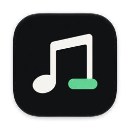
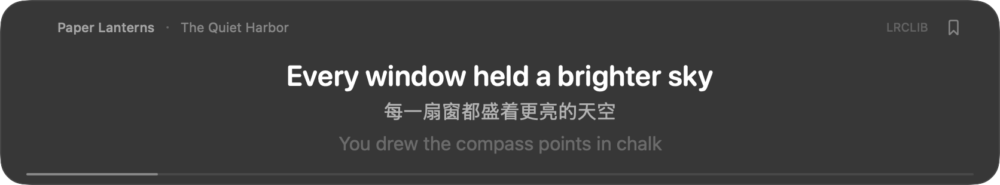
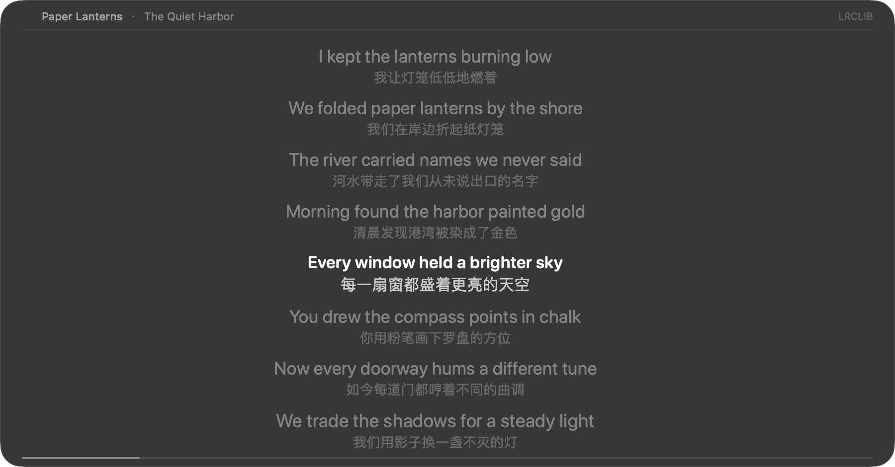
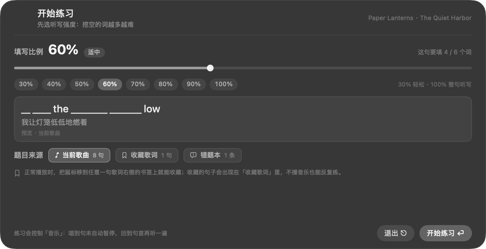
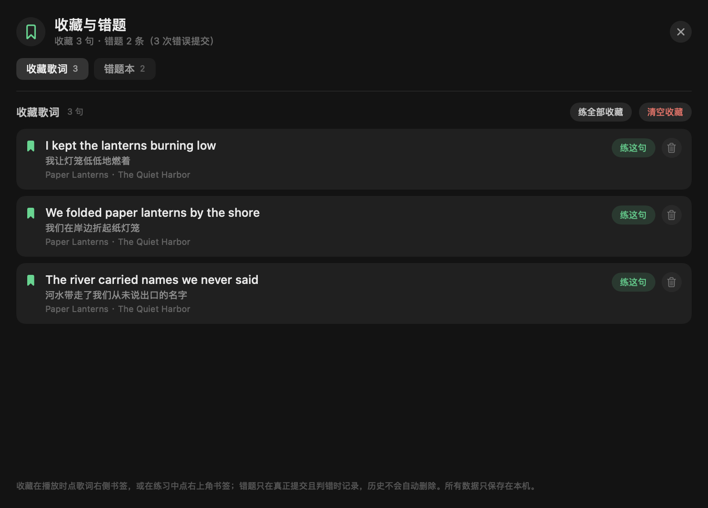
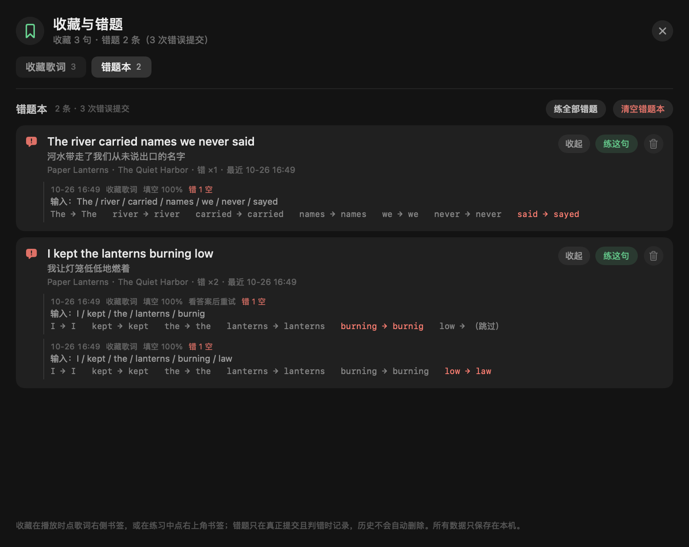
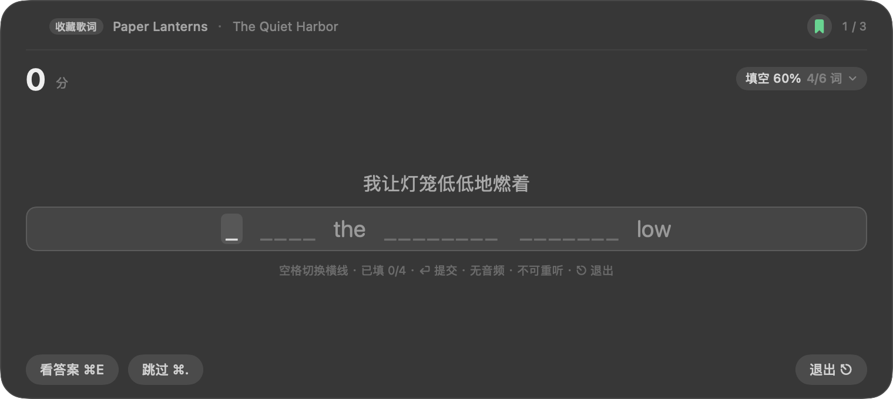
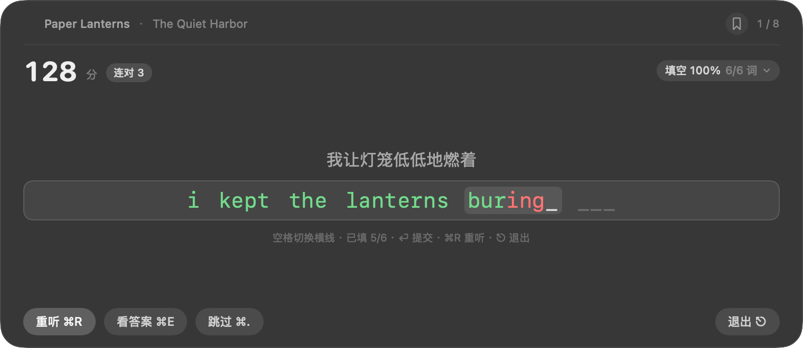
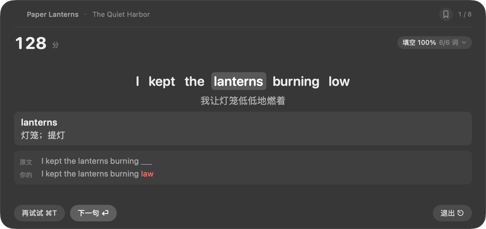
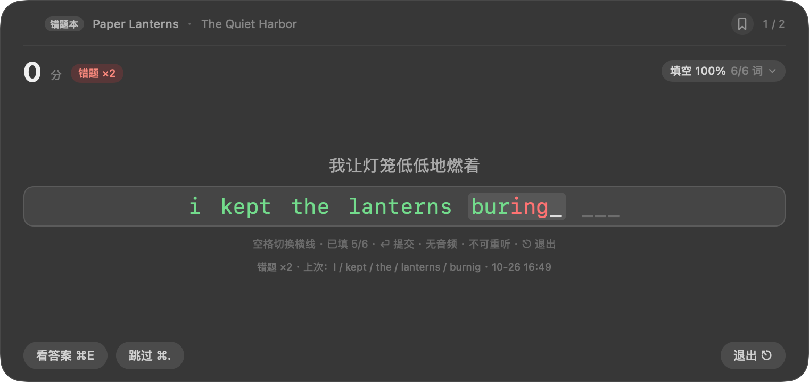

<p align="center">
  
</p>

# GapSong · macOS 歌词悬浮窗 + 填空听写

[](#系统要求)
[](https://swift.org)
[](LICENSE)

把 Apple Music 的歌词变成能听、能填的英语练习：悬浮歌词同步滚动、端上翻译，喜欢的句子收进「收藏歌词」，答错的句子自动进「错题本」，按 30%–100% 的强度做填空听写。不注入、不修改 Apple Music 本体；翻译离线完成，收藏、错题和设置只存在本地。

> **Gap** 就是歌词里被挖掉的那个空：边听边填，填完接着唱。

紧凑模式（836×155）：



全文模式（900×470，可滚动查看整首歌词，当前句高亮、手动滚动后暂停跟随）：



开始练习前先选填写比例（30% 只挖三成词，100% 整句听写），下面会实时预览挖空效果：



收藏与错题放在一个深色轻量窗口里：可查看原文/译文/歌曲、单句删除、从列表直接练一句或练整个库；错题展开还能回看每一次错误提交：





收藏过的句子可以不播音乐直接练，题目会打乱顺序，答题界面同样支持点词查义：



听写模式（780×400，唱完一句自动暂停，直接在横线上打字，对的字母变绿、错的变红）：



答完揭示答案后，点任意单词查含义：



错题本练习不依赖音频：顶部显示「错题 ×N」，可回看上次错在哪里；没有重听按钮：



---

## 系统要求

- macOS 15（Sequoia）或更高版本；
- 从源码构建需要 Xcode Command Line Tools：`xcode-select --install`；
- 首次运行需要授予「控制音乐」的自动化权限。

## 安装

当前先开放源码，尚未发布可下载的正式安装包。可按下面步骤自行构建；后续安装包会出现在 [Releases](https://github.com/ZouQi523/GapSong/releases)。

### 从源码构建

```bash
git clone https://github.com/ZouQi523/GapSong.git
cd GapSong
./build.sh                     # 产物在 build/GapSong.app
open build/GapSong.app         # 也可以拖进 /Applications

# 可选：连同安装到 /Applications
./build.sh --install
```

构建同时生成 `build/GapSong.zip`，内含已验证本地签名的应用。若工程位于云同步目录，建议从 ZIP 解压到「应用程序」后使用，避免同步服务附加的文件元数据影响签名。

> 默认按当前机器架构构建（Apple Silicon 得到 arm64，Intel Mac 上得到 x86_64）。通用二进制还在 Roadmap 里。

首次运行会依次请求两项系统权限：

| 权限 | 时机 | 位置 |
|---|---|---|
| 控制「音乐」 | 启动后第一次读取播放状态 | 系统设置 › 隐私与安全性 › 自动化 |
| 下载翻译语言包 | 播放第一首需要翻译的歌时，系统弹窗 | 点弹窗里的「下载」，等待完成 |

然后打开「音乐」播放任意歌曲即可。菜单栏有一个 ♪ 图标，所有开关都在那里（也可以右键歌词窗）。

> 翻译语言包只需下载一次（按语言对，几百 MB）。下载期间歌词窗会显示「首次使用：请在系统弹窗中允许下载语言包…」。

> **从旧版 LyricFloat 升级**：GapSong 首次启动会自动迁移 `~/Library/Application Support/LyricFloat` 与 `~/Library/Caches/LyricFloat` 里的收藏（旧称题库）、翻译缓存，并沿用旧偏好。收藏文件仍是 `questions.json`，旧 ID/原文不变。因为 Bundle ID 改成了 `com.gapsong.app`，系统会重新询问一次「控制音乐」权限。

### 练习（听写）

1. 菜单栏 ♪ ›「开始练习（听写）…」，或右键歌词窗 › 同名菜单；菜单里也直接有「练当前歌曲 / 练收藏歌词 / 练错题本」；
2. 选**填写比例**（30%–100%，右上角可随时改）和**题目来源**（当前歌曲 / 收藏歌词 / 错题本），点「开始练习」；
3. 正常播放时，把鼠标移到任意一句歌词右侧的 **书签** 上，就能收藏这一句（再点一次移除）；练习中也能点右上角书签收藏当前句；
4. 不想开音乐时，直接选「收藏歌词」或「错题本」来源出题：判分、看答案、点词查义都照常，完全离线；错题本还会显示每句的错误次数和上次错误。

---

## 功能

- **歌词自动匹配**：按「歌名 + 歌手 + 专辑 + 时长」查 LRCLIB（第三方歌词服务，提供 LRC 时间轴），失败再用搜索兜底；结果本地缓存 90 天。
- **逐行同步**：400ms 采样 Music 的播放位置并在本地插值，20fps 刷新，`[offset:]`、一行多时间戳、纯文本歌词都能处理。
- **端上翻译**：使用系统 `Translation.framework`，离线、不上传歌词。默认译为简体中文，可切繁中 / English / 日本語 / 한국어。
- **翻译缓存**：同一句只翻一次，跨歌曲、跨重启复用（`translations.json`）。
- **窗口可调**：拖右下角手柄自由缩放（最小 420×110），或菜单「窗口大小」选紧凑 / 标准 / 大 / 宽屏；位置和尺寸都会记住。
- **字号可调**：菜单「字号」里有 4 档预设，也能 ±2 连续放大缩小（14–72）。
- **全文模式**：窗口高度 ≥250 自动切到全文视图，可上下滚动看整首歌词（当前句高亮、**字号加大**，其余变暗、每句带译文）；手动滚动会暂停自动跟随 10 秒，点「↓ 回到当前」立刻归位。窗口缩回矮条则自动回到三行模式。
- **听写练习**：每唱完一句自动暂停，给出按强度挖空的下划线与整句中文，请你写下被挖掉的词；`空格` 在空之间切换，可以只填有把握的部分；判分后逐词对照，可反复重听、随时看答案、点词查义，并累计积分与连对。详见下方「练习模式」。
- **悬浮窗**：置顶、跨桌面与全屏 App 可见、显示/隐藏翻译、进度条。
- **拖动**：按住顶部标题栏（整条 28pt，全宽）任意位置拖动；App 不在最前时**第一次点击就能拖**。锁定后标题栏会出现 🔒 图标，此时不可移动。
- **退出**：窗口左上角有 `×` 按钮，点一下直接退出；也可以右键 ›「退出 GapSong」或菜单栏 ♪ ›「退出」。
- **填空强度**：30%–100% 可选，按句内词位置稳定挖空（同一句每次都挖同样的词，不会打着字横线乱跳），练习中也能随时切换。
- **收藏歌词**：播放时每句右侧有书签，点一下收藏；歌词窗和练习界面都能收藏当前句，提示会显示「已收藏 · 共 N 句」。数据仍在 `questions.json`，重启仍在，同一句不重复收藏。
- **收藏练习**：完全不启动音乐也能从收藏随机出题；答完可看答案、看错词对照、点词查义，收藏里的句子自带歌曲信息。
- **错题本**：只有「真正提交且判错」才入库；跳过、空提交、只看答案、逐字红色提示、没填的空都不记。同一句合并成一条，保留每一次错误提交的完整历史。
- **错题练习**：不启动/控制音乐，直接文本练习；顶部显示错题次数与上次错误，可看答案、再试、下一句；没有音频，也没有重听。
- **直接入口与管理**：右键歌词窗和菜单栏都有「练当前歌曲 / 练收藏歌词（N）/ 练错题本（N）/ 查看收藏与错题」；空库入口仍显示但置灰并说明。管理窗口可查看、单句删除、从列表练一句或练全部；清空需要二次确认。
- **零侵入**：不改 Apple Music、不录音频、不碰 DRM。

---

## 练习模式（听写）

用歌词练听力、拼写和回想：**选强度 → 听一句（或直接看题）→ 看中文回想英文 → 写下被挖空的词 → 逐词对照 → 点词查义**。

菜单栏 ♪ ›「开始练习（听写）…」，或右键歌词窗 › 同名菜单。开启时先进入设置页（窗口自动放大到适合答题的尺寸，退出时恢复）。

### 强度与题目来源

设置页里做两个选择，点「开始练习」：

- **填写比例（30%–100%）**：这句话里有多少词要被挖空。30% 只挖三成、其余词作为提示露出来；100% 就是整句听写。滑杆按 5% 吸附，下面会实时预览这句的挖空效果。
- **题目来源**：
  - `当前歌曲`：用正在播放的歌，唱到句末自动暂停；
  - `收藏歌词`：用你收藏过的句子出题，**完全不启动音乐**，题目顺序随机；
  - `错题本`：用本机错题本出题，同样不启动/控制音乐；没有音频，也没有重听。

练习中右上角的「填空 xx%」可以随时改强度（当前这句立刻按新比例重挖）；右键 ›「练习选项」还能换来源、返回设置页。切换来源会先结束旧会话：停止歌曲计时、取消自动下一题，避免旧任务推进新题。

### 收藏歌词与错题本

正常播放时，每一句歌词右侧都有一个 **书签**（鼠标移上去变亮）：

- 点一下收藏（变成实心），再点一次取消；歌词窗、练习界面都能收藏当前句；
- 收藏时连歌曲名、歌手、译文一起存下来，练习时不用重新匹配；
- 存在 `~/Library/Application Support/GapSong/questions.json`，重启仍在；同一首歌的同一句只存一次；
- 中文/日文等没有可听写字母的行，按钮是灰的。

错题本与收藏完全分开，存在 `~/Library/Application Support/GapSong/mistakes.json`：

- 只在**真正提交且判错**时写入；逐字红色提示、跳过、空提交、只看答案都不算；
- 同一句按「歌手 + 歌名 + 原句」合并成一条，每次错误追加历史，不自动删除；
- 历史包含完整原句、当时译文、歌名歌手、句子时间、提交时间、题目来源、挖空比例、逐空位置/期望/实际、原始输入；
- 部分填空跳空后，跳过的空也会保留位置，错误位置仍能对上；
- 看答案后再试虽然不计分，但真正判错仍会记录；
- 答对不会删除旧记录；再次练错继续追加；
- 错题保存/读取失败会在管理窗口和练习界面显示警告；读不出的原始文件会先备份为 `mistakes.corrupt-*.json` 再写新文件，不会静默覆盖。

点菜单「查看收藏与错题…」打开管理窗口：列表显示原文、译文、歌名歌手，可单句删除；「练这句」只练一条，「练全部」练整个库；错题行可展开查看每一次提交。批量清空会弹二次确认，点「取消」不改变任何数据。

### 流程（当前歌曲）

1. 从当前播放位置往后找第一句可练的歌词，跳到句首开始播放。
2. 唱到句末自动暂停，并把播放位置精确拉回句首。
3. 画面给出整句中文 + 按强度挖空的下划线（每个下划线对应一个字母），没被挖的词直接露出来当提示。
4. **直接在横线上打字**：对的字母立刻变绿，错的变红，剩下的还是下划线；退格键可以改。单词之间的空格和标点不用打，判分也不计较（空格键用来切换横线，不会输入空格）。
5. **填满当前空会自动跳到下一个空**；也可以按 `空格` 手动切换（当前空有一层浅底色）。用户不必填满所有空，不会的可以直接跳过去填下一个，空格会在所有空之间循环。
6. `Enter` 提交：只判你真正填过的空，跳过的空不算错。答对显示原文 + 译文，1.8 秒后自动进入下一句。
7. 答错：横线上保留你的输入（红色标出听错的字母），可以继续改；也可以按 `⌘R` 反复重听这一句，次数不限，已输入的内容不会丢。
8. 「看答案」任何时候都能点；揭示后可以点任意单词查含义，也可以选「再试试」重新填这一句（不计分），或「下一句」继续。

### 流程（收藏歌词 / 错题本）

1. 从收藏或错题本随机取题，直接显示答题界面；不播放、不控制「音乐」，也不抢播放状态；
2. 挖空比例、空格切换横线、只填部分空、判分、看答案、点词查义都和「当前歌曲」一致；
3. 没有「重听」按钮（没有音频可放），提示里会写明「无音频 · 不可重听」；揭示后同样可以「再试试」；
4. 错题本练习顶部有「错题 ×N」，并回看上次错误输入；管理窗口可展开全部历史；
5. 练完显示得分/答对/答错，可以「再来一遍」（单句练习仍是同一句，整库练习重新打乱）或「重新选择」换强度。

**键盘操作**（不用鼠标也能全程使用）

| 按键 | 作用 |
|---|---|
| `⏎` | 提交答案；揭示答案后为「下一句」；练完后为「再来一遍」 |
| `空格` | 手动切换当前要填的横线（在全部空之间循环，可只填一部分） |
| 打字 | 当前空填够该词的字母数后自动跳到下一个空 |
| `⌘R` | 重听这一句（不限次数，输入保留；收藏歌词 / 错题本无此项） |
| `⌘E` | 看答案 |
| `⌘T` | 看过答案后再试一次（不计分） |
| `⌘.` | 跳过这一句 |
| `⎋` | 退出练习 |
| `⌘Space` | 切换到英文输入法 |

按钮上直接印着对应快捷键。`⎋` 用 `onExitCommand` 实现，输入法组字时 Esc 会先给输入法用，不会误退出；其余快捷键是普通的 key equivalent。

> 暂不提供“选中文字/歌词”的操作：答题框是透明的，鼠标点选、`⌘A`、`Shift+方向键` 都不会产生选区（避免出现白色选中条）。输入法正在组字时，空格和方向键会先交给输入法。

**积分**

| 事件 | 分数 |
|---|---|
| 听对（填满） | +8 ~ +12（30% 强度 8 分，之后每档 +1，100% 12 分） |
| 只填了一部分 | 按“已填空数 / 总空数”折算基础分，最低 1 分；跳过的空不扣分，也不给分 |
| 连对第 2 / 3 / 4 句起 | 额外 +2 / +4 / +6 |
| 看答案、跳过、答错 | 0 分，连对清零（不扣分） |

重听不扣分——反复听是正常的学习方式，不该被惩罚。积分按每次练习累计；换歌、换来源或「再来一遍」会清零。

错误提交（真正按 `⏎` 且判错）会写进错题本，但不会额外扣分；错题练习本身仍按上面的积分规则计分。

**错题记录**

| 字段 | 内容 |
|---|---|
| 原句 / 译文 / 歌名歌手 / 句子时间 | 提交时的快照；译文缺失时显示翻译缓存里的结果 |
| 提交时间 / 题目来源 | 当前歌曲 / 收藏歌词 / 错题本 |
| 挖空比例 | 当次 30%–100% |
| 逐空 | 第几个空、原句词下标、期望词、实际填写、是否跳过；部分跳空仍能对齐 |
| 原始输入 | 输入缓冲；管理窗口同时给出按空分隔的可读摘要 |
| 次数 | 同一句合并，保留每一次；答对不删旧记录 |

**判分规则**（宽进严出）

| 情况 | 判定 |
|---|---|
| 大小写、标点、弯引号 | 忽略 |
| 空格与词界（整句连写 `morningfoundtheharborpaintedgold`） | 判对（横线着色本来就忽略空格） |
| 缩写漏撇号（`dont` / `don't`） | 判对 |
| 数字与英文（`4` / `four`） | 判对 |
| 换词、少字母（`word` / `world`） | 判错，逐格标红 |
| 只填了部分空（空格跳过） | 只判已填的空；跳过的空不算错 |
| 连字符（`all right` / `alright`） | 判错（是不同词） |

> 判分和横线着色共用同一个字符口径（`DictationJudge.comparisonChars`），
> 所以不会出现「满屏绿字却判错」。自检里有一条不变式在守这个约束：
> 逐格全绿 ⇒ 必然判对。

**会跳过哪些句子**（仅「当前歌曲」来源）

- 纯符号行（`♪`）、`Oh oh oh` 这类重复感叹
- 日文/中文/韩文行（拉丁字母占比 < 90%）
- 少于 3 个词、或只有 1 个不同词的行
- 与上一句完全相同的连续重复行
- 时长不足 1.2 秒的行

**字号与窗口**：听写界面的字号、间距、按钮都按窗口大小等比缩放，拖大窗口字也会跟着变大。下划线区整体居中，输入的文字直接落在下划线上。

**句末停在哪儿**

LRC 只标了每句的**开始**时间，所以「这句唱完」只能用下一句的开始时间近似。默认会在下一句开始后再放 **0.2 秒**才暂停——宁可多听半个音，也不要把这一句的尾巴切掉。

如果觉得还是切得早，或者反过来听到了下一句的开头，右键歌词窗 ›「句末停得早/晚」可以直接调，立即生效：

| 选项 | 含义 |
|---|---|
| 提前 0.1 / 0.2 s | 更早停（适合句间有明显空白、又不想听到下一句的歌） |
| 准时停 | 恰好停在下一句开头 |
| 延后 0.1 / 0.2 / 0.35 / 0.5 s | 更晚停（默认 0.2） |

这个值存在偏好里，之后一直沿用。

---

## 命令

```bash
# 自检：歌词抓取、LRC 解析、判分、收藏兼容、错题持久化/多次历史/部分跳空、
#       离线错题练习、来源切换、坏文件保护、隔离模式、翻译可用性
# 任何一项失败都会以非 0 退出码结束（输出里有 ✗ 和失败计数）
./build/GapSong.app/Contents/MacOS/GapSong --selftest

# 把界面离屏渲染成 PNG（改样式时用）
./build/GapSong.app/Contents/MacOS/GapSong --snapshot docs/screenshots/preview.png

# 渲染听写界面（预览用，不需要真的放歌）
./build/GapSong.app/Contents/MacOS/GapSong --snapshot-practice docs/screenshots/practice.png

# 渲染「揭示答案 + 点词查义」状态
./build/GapSong.app/Contents/MacOS/GapSong --snapshot-practice-answer docs/screenshots/practice-answer.png

# 渲染「看过答案后重试」状态
./build/GapSong.app/Contents/MacOS/GapSong --snapshot-practice-retry /tmp/retry.png

# 把「练习设置」和「收藏歌词练习」界面渲染成 PNG
./build/GapSong.app/Contents/MacOS/GapSong --snapshot-practice-setup docs/screenshots/practice-setup.png
./build/GapSong.app/Contents/MacOS/GapSong --snapshot-practice-bank docs/screenshots/practice-bank.png

# 渲染收藏管理、错题管理、错题练习（预览用，不读写真实收藏/错题）
./build/GapSong.app/Contents/MacOS/GapSong --snapshot-favorites docs/screenshots/favorites.png
./build/GapSong.app/Contents/MacOS/GapSong --snapshot-mistakes docs/screenshots/mistakes.png
./build/GapSong.app/Contents/MacOS/GapSong --snapshot-practice-mistakes docs/screenshots/practice-mistakes.png

# 演示模式：不用真的放歌，直接模拟一首歌跑完整链路
open -a "$PWD/build/GapSong.app" --args --demo

# 调试：模拟英文歌并直接进答题态，用来验证键盘输入（不碰真实播放）
open -a "$PWD/build/GapSong.app" --args --demo -practiceMode YES --practice-ask

# 调试：直接从收藏出题（不播放音乐；收藏为空时界面会提示）
open -a "$PWD/build/GapSong.app" --args --demo -practiceMode YES --practice-bank
```

调试日志写在 `~/Library/Caches/GapSong/diag.log`，可用 `GAPSONG_HOME=/some/dir` 改写输出目录（旧版的 `LYRICFLOAT_HOME` 仍兼容）。

---

## 实现要点

| 环节 | 做法 |
|---|---|
| 读取播放状态 | AppleScript（`NSAppleScript`，独立串行队列，400ms 采样），`with timeout 4` 防卡 |
| 位置平滑 | 采样点 + 本地时钟插值，避免 0.4s 一跳 |
| 歌词源 | `https://lrclib.net/api/get` → 失败走 `/api/search`，按时长差排序挑最接近的版本 |
| 翻译 | SwiftUI `.translationTask(configuration)` 拿 `TranslationSession`，`translations(from:)` 批量翻；语言包未安装时系统自动弹下载确认 |
| 窗口 | `NSPanel`（`.borderless + .nonactivatingPanel`，`.floating`，`.canJoinAllSpaces`），顶部 28pt 自绘拖拽区（`acceptsFirstMouse`，非激活时第一次点击即可拖动） |
| 听写控制 | AppleScript `pause` / `set player position` / `play`，与读取同属 `com.apple.Music.playback` 权限组，无需二次授权 |
| 填空 | `PracticeBlanks` 用文本 FNV-1a 哈希决定取词起点、等距选词：同一句每次都挖同样的位置，非拉丁行不挖空 |
| 收藏歌词 | `QuestionBank` 存 `~/Library/Application Support/GapSong/questions.json`，按「歌名 + 句子」去重（`GAPSONG_HOME` 可覆盖） |
| 错题本 | `MistakeBook` 存 `mistakes.json`；身份 = 歌手 + 歌名 + 原句，逐次追加历史，不推断掌握度、不自动删除 |
| 播放控制 | `PracticeEngine` 只依赖 `MusicControlling` 协议；自检/快照注入 `Spy`/`Noop`，绝不向真实 Music 发命令 |
| 隔离 | `AppRuntime` 为 `--selftest` / `--snapshot*` 提供临时数据目录与独立 `UserDefaults` suite，不写真实偏好 |

## 文件结构

```
Sources/GapSong/
  main.swift            入口（--selftest / --snapshot / 正常启动）
  AppDelegate.swift     生命周期、菜单栏菜单
  MusicWatcher.swift    AppleScript 采样 + 快照解析
  PlayerState.swift     当前歌曲/歌词/行索引
  LRCLIB.swift          歌词 API + 磁盘缓存
  Models.swift          LRC 解析、数据模型
  TranslationEngine.swift  端上翻译队列 + 缓存 + 状态机
  DictationJudge.swift     听写判分（正规化、词级对齐）
  PracticeEngine.swift     听写状态机、行过滤、播放控制
  PracticeView.swift       听写界面（SwiftUI）
  OverlayView.swift     歌词窗 UI（SwiftUI）
  OverlayController.swift  NSPanel 承载、尺寸、位置记忆
  PracticeBlanks.swift  填空强度算法（按比例稳定挖词）
  QuestionBank.swift    收藏歌词模型 + JSON 持久化
  MistakeBook.swift     错题本模型 + 多次历史 + 坏文件备份
  LibraryView.swift     收藏/错题管理窗口 + 错题历史展开
  AppRuntime.swift      自检/快照隔离模式（目录 + UserDefaults）
  PracticeSetup.swift   练习设置页（强度 / 来源 / 预览）
  Settings.swift        偏好设置（UserDefaults）
  Diag.swift            诊断日志
  SelfTest.swift        命令行自检
  SnapshotTool.swift    离屏渲染预览图
```

## 状态与排错

歌词窗右上角的小字是翻译状态：

| 状态 | 含义 |
|---|---|
| 准备翻译… | 已排队，等待系统翻译会话启动（正常只闪一下） |
| 首次使用：请在系统弹窗中允许下载语言包… | 需要你在系统弹窗点「下载」，最大等 180 秒 |
| 翻译中… N 行 | 正在逐批翻译（换歌会接着翻，不用重开） |
| 等待语言包就绪，20 秒后自动重试… | 上次被取消，会自动重试（最多 2 次） |
| 翻译未完成：… | 被取消/超时，右键 ›「重试翻译」 |
| （显示 LRCLIB） | 这首歌不需要翻译（中文歌译为中文）或翻译已完成 |

如果卡在「准备翻译…」，右键 ›「重试翻译」；仍不行就看 `~/Library/Caches/GapSong/diag.log`。

练习相关：收藏为空时「收藏歌词」来源/菜单入口会置灰，先在播放时点歌词右侧书签；错题本为空时同理，必须先真正提交一个错误。练习中右上角的「填空 xx%」可以直接改强度，右键 ›「练习选项」里还能切来源、返回设置页。错题本读写失败时，管理窗口和练习界面会显示警告，不会假装保存成功。

## 隐私

- 不收集遥测或统计数据，没有账号，也没有自建服务器；
- 歌词匹配会把「歌名 / 歌手 / 专辑 / 时长」发给 [LRCLIB](https://lrclib.net)，这是应用主动发起的网络请求（结果本地缓存 90 天）；系统翻译语言包的首次下载由 macOS 处理；
- 翻译使用系统 `Translation.framework`，在本机完成，不上传歌词；
- 收藏、错题、设置、翻译缓存分别保存在 `~/Library/Application Support/GapSong` 和 `~/Library/Caches/GapSong`（收藏 `questions.json`、错题 `mistakes.json`）；
- 通过 AppleScript 读取/控制「音乐」的播放状态，不读取音频、不碰 DRM。

## 已知限制

- 歌词来自第三方库，冷门歌/现场版可能查不到；纯文本歌词没有时间轴，只显示前 4 行。
- 搜索兜底时会按时长挑版本，极端情况下可能匹配到翻唱或英文版。
- 翻译是系统模型逐句翻，质量中等；不结合整首上下文（可后续接 LLM 替换 `TranslationEngine`）。
- 依赖 macOS 15+（`Translation.framework` 的最低版本）。
- 只支持 macOS；iOS 端无法注入 Apple Music，只能做独立播放器 App（MusicKit + 自绘歌词页）或灵动岛 Live Activity 方案。
- 收藏歌词/错题本只练拉丁字母句子（英文等），中文/日文行收藏按钮会置灰；填空比例按「词数」取整，短句可能只挖 1 个词。
- 收藏/错题练习没有音频，不能重听；错题历史只保存提交时的快照，不推断掌握度，也不会自动删除。
- 错题身份按「歌手 + 歌名 + 原句」；同名不同歌手的同一句会分开记录。
- 听写模式对时间轴精度比看歌词敏感得多：LRC 时间轴偏 0.5 秒，句末暂停就会切到下一句的开头。先用右键菜单里的「句末停得早/晚」补偿；如果整首歌都偏，说明歌词源本身不准。
- 每句的结束点是按「下一句的开始」推断的，没有上限。万一遇到两句之间是长间奏（十几秒），会等得比较久——按「跳过这句」即可。
- 听写时每句都会抢一次键盘焦点（不然没法输入）。如果只是听歌，别开这个模式。
- Apple Music 不支持变速（脚本字典里没有播放速率属性），所以快歌只能靠重播，不能放慢。
- LRC 本身有错字时，听写会一直判错——先「看答案」跳过这一句。
- 点词释义用的是端上翻译引擎（本机没有装系统词典时 `DCSCopyTextDefinition` 返回空，所以没走词典路线）。它脱离上下文，多义词可能给的是最常见义项（比如 `rule` 会显示「规则」而不是「统治」）；句子整句译文就在上方，可以对照判断。
- 答题时显示中文会降低难度。如果只想练纯听力，把菜单里的「显示翻译」关掉即可。

## Roadmap

- [x] App 图标
- [x] 收藏歌词 / 错题本管理窗口
- [ ] Release 公证
- [ ] 通用二进制（Apple Silicon + Intel）
- [ ] 更完整的自动化测试（练习状态机 / UI 冒烟）
- [ ] 可选接入 LLM 翻译
- [ ] 更多题型（中译英、整段听写）

## 贡献

欢迎 Issue 和 PR。动手前请先读 [CONTRIBUTING.md](CONTRIBUTING.md) 与 [CODE_OF_CONDUCT.md](CODE_OF_CONDUCT.md)。

安全相关问题请按 [SECURITY.md](SECURITY.md) 私下报告，不要直接开公开 Issue。

## 示例素材与第三方内容

仓库中的演示歌词、译文和截图使用为本项目编写的原创示例，来源说明见 [演示素材说明](docs/demo-materials.md)。实际播放时获取的歌词归各自权利人所有；本项目的 GPL 许可证不授予第三方歌词、音乐或商标的使用权。

## License

GapSong 以 [GNU General Public License v3.0](LICENSE) 发布，Copyright (C) 2026 NeoZou。

你可以自由使用、修改和分发；如果分发修改后的版本，需要同样以 GPL-3.0 开源，并提供对应源码。
